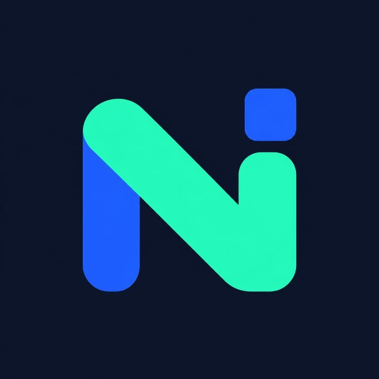

<p align="center"></p>

# Nodrelay · Stable downloads

Connect Mac, Windows and Linux devices to one MCP gateway in your own Cloudflare account.

[Latest stable release and downloads](https://github.com/Erlin0220/nodrelay-downloads/releases/latest) · [Release history](https://github.com/Erlin0220/nodrelay-downloads/releases) · [简体中文](README_zh-cn.md)

## Deploy the console from a Mac

Use a domain active in your Cloudflare account. In Terminal, run:

```zsh
zsh <(curl -fsSL https://github.com/Erlin0220/nodrelay-downloads/raw/main/mac)
```

Append `--plan` for a read-only installation plan. The launcher checks the archive and the installer verifies the publisher signature.

## Connect a device and ChatGPT

1. In the console, choose **Add device → Add and install**. Copy the command for your operating system and run it on the device. Packages are available for Apple Silicon Macs, Windows x64 and Linux x64. Unattended Linux hosts need a systemd user service and user lingering.
2. Add the console’s MCP gateway URL to ChatGPT and select **OAuth**. New gateways have a 30-day authorization session with background token refresh. Adding another device does not require a new ChatGPT connection.
3. Ask ChatGPT to list devices and select the one you want. Tools run with the privileges of the account running Nodrelay on that device.

The console and clients use the signed stable update channel. Existing preview installations stay on their original channel.
