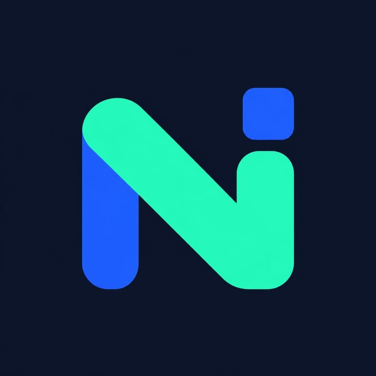

<p align="center"></p>

# 诺联 · 正式版下载

一个 MCP 网关连接你的 Mac、Windows 和 Linux 设备。管理台部署在你自己的 Cloudflare 账户中。

[最新正式版和安装包](https://github.com/Erlin0220/nodrelay-downloads/releases/latest) · [历史版本](https://github.com/Erlin0220/nodrelay-downloads/releases) · [English](README.md)

## 在 Mac 上部署管理台

准备一个已在 Cloudflare 激活的域名，在 Mac 终端执行：

```zsh
zsh <(curl -fsSL https://github.com/Erlin0220/nodrelay-downloads/raw/main/mac)
```

在命令末尾加 `--plan` 只查看安装计划。启动脚本校验安装包，安装器验证发布签名。

## 接入设备和 ChatGPT

1. 在管理台点「添加设备 → 添加并安装」，复制对应系统的命令，在目标设备执行。支持 Apple Silicon Mac、Windows x64 和 Linux x64。无人值守的 Linux 主机需要 systemd 用户服务和 linger。
2. 在 ChatGPT 添加管理台显示的 MCP 网关地址，选择 **OAuth** 登录。新网关的授权会话为 30 天，期间支持后台刷新。新增设备不需要重新连接 ChatGPT。
3. 让 ChatGPT「列出设备」并选择目标。工具以该设备上运行诺联的账号权限执行。

管理台和客户端通过签名的正式通道更新。已有预览部署保留原通道，不会自动切到正式版。
